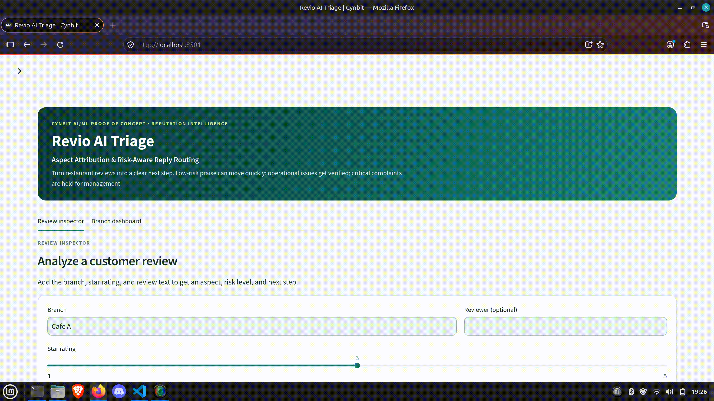
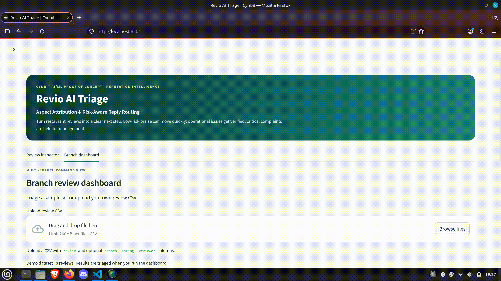

# Revio AI Triage

**Aspect attribution and risk-aware reply routing for customer reviews.**

Revio AI Triage is a Streamlit proof of concept for a reputation-management
workflow. It uses a Hugging Face zero-shot natural language inference (NLI)
model to identify review topics and risk, then routes each review into one of
three operational lanes. The sample data represents a fictional multi-location
restaurant and cafe group.

> **Proof of concept:** This app is decision-support only. It does not connect to
> review platforms or publish replies.

## Product demo

Two short recordings will demonstrate the app's main workflows.

### Review inspector



### Branch dashboard



## What it does

- **Review inspector:** Analyze a review by branch and star rating; view the
  predicted aspect, risk, confidence, rationale, and recommended route.
- **Branch dashboard:** Triage the included sample reviews or upload a CSV to
  compare review volume and routing across branches.
- **Risk-aware routing:** Use confidence-gated routing and conservative phrase
  overrides to hold potential safety, payment-fraud, and legal concerns for
  management review.
- **Reply drafting:** Generate a suggested response for eligible reviews;
  higher-risk reviews are held rather than given a public reply.

## Routing lanes

| Lane | Route | Intended handling |
| --- | --- | --- |
| **A · Auto-Publish** | Routine, low-risk feedback | Eligible replies may be published under admin policy. |
| **B · Advisor Draft Queue** | Branch-level service or operations issue | An advisor reviews the draft before publishing. |
| **C · Manager Crisis Hold** | Safety, hygiene, fraud, or legal signal | Block public auto-reply and escalate to management. |

Admin policy governs lane thresholds; it does not mean every Lane A item needs
individual admin approval. Low-confidence, non-crisis predictions stay in the
Advisor queue. Lane C has no reply draft. Phrase overrides conservatively raise
some explicit crisis signals even when the model score is uncertain.

## Requirements

- Python **3.12** (the version is recorded in `.python-version`)
- [`uv`](https://docs.astral.sh/uv/)
- Network access on first analysis to download the
  `valhalla/distilbart-mnli-12-1` model from Hugging Face

The model is loaded lazily and runs on CPU. The first model-backed analysis may
take longer while the model is downloaded and initialized.

## Quick start

From this directory:

```bash
uv sync
uv run -m streamlit run app.py
```

To run the model-independent routing checks:

```bash
uv run python test_engine.py
```

These checks do not download or initialize the Hugging Face model.

## Using the app

1. In **Review inspector**, analyze the prefilled example or enter a branch,
   rating, and review.
2. Review the predicted aspect, risk level, confidence, rationale, and assigned
   lane.
3. Open **Branch dashboard** and run the sample set, or upload your own CSV.
4. Compare branch-level routing counts and inspect escalations.

CSV uploads must include a `review` column. The following columns
are optional:

| Column | Description |
| --- | --- |
| `branch` | Branch or location name |
| `rating` | Star rating from 1 to 5 |
| `reviewer` | Reviewer name or identifier |

Blank review rows are ignored.

## Project structure

| File | Purpose |
| --- | --- |
| `app.py` | Streamlit review inspector and multi-branch dashboard |
| `engine.py` | Typed review/result schemas, lazy NLI classifier, risk handling, reply drafting, and routing policy |
| `test_engine.py` | Model-independent routing checks |
| `pyproject.toml` | Project metadata and direct dependency declarations |
| `uv.lock` | Locked dependency versions used by `uv sync` |

## Limitations

Model predictions and phrase overrides are prototypes, not guarantees of
correct classification. 
